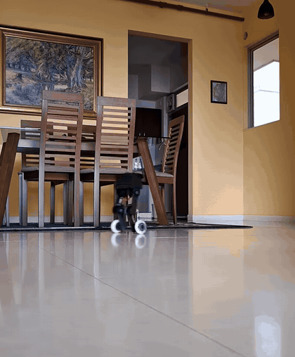
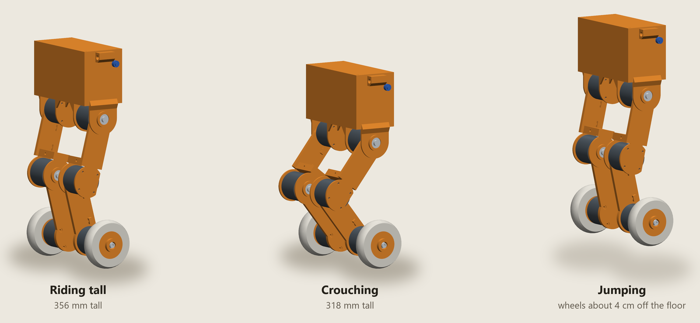
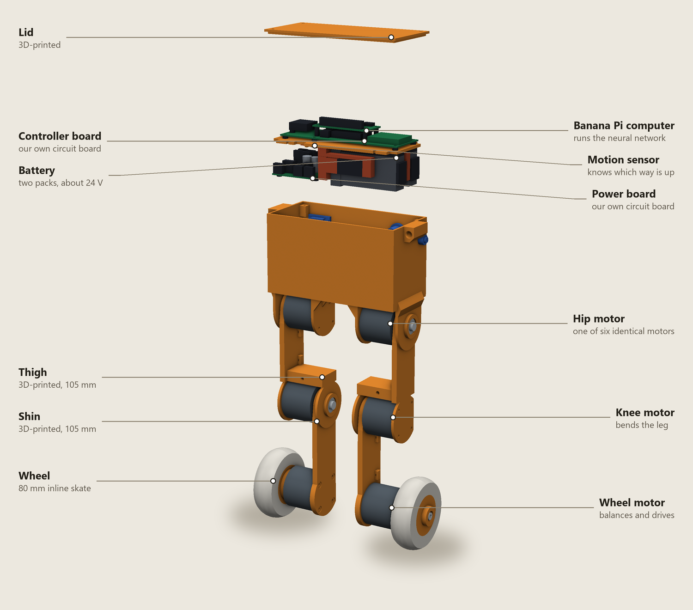

# Skaterbot

Skaterbot is a 36 cm robot that stands on two legs and rolls on inline-skate
wheels. It is 3D-printed, weighs about 2 kg, and keeps itself upright with a small
neural network that learned to balance in simulation before it ever touched a real
floor.

<p align="center">
  <a href="https://youtube.com/shorts/mM_8cwL3qOs"></a>
</p>
<p align="center"><a href="https://youtube.com/shorts/mM_8cwL3qOs">Watch the clip on YouTube</a> (15 seconds, filmed 6 November 2026)</p>

Nobody wrote down how to balance. The robot's six motors are driven by what the
network worked out for itself, falling over again and again in simulation, and the
same network then runs on the real machine. The project was called Biped until
November 2026, and the old word survives in names that code or the running robot
depends on.

## What it does

- **Balances on two wheels.** It stands and drives with nothing holding it up,
  deciding what all six motors should do 100 times a second.
- **Drives from an Xbox controller.** A full pull settles at about 1.5 m/s
  forwards, a brisk walk, and reversing is capped at the same speed. It turns as
  it goes, and learns how much steering it takes to hold a straight line.
- **Changes height.** Its legs fold, and the D-pad sets how tall it rides, between
  318 and 356 mm.
- **Jumps.** Hold A to crouch and let go to jump. In one session of 24 jumps, the
  wheels typically cleared the floor by 37 mm and it landed every time. That height
  is worked out from the logged joint angles, not filmed against a scale.

It first stood on its own on 5 November 2026, and was jumping three days later.



*Drawn from the CAD at heights the real robot uses. The orange parts are the
printed ones, which are black on the real robot.*

## What's inside

The robot began as an eight-motor walking design. Swapping its feet for wheels
removed the ankles and the sideways hip joints, and left two joints and a wheel on
each leg.



| Part | Role |
|---|---|
| Six [DAMIAO DM-J3507-2EC](reference/motors/README.md) motors | One at each hip and knee and one on each wheel, 165 g each. Their low gearing lets the joints give under load instead of fighting it. |
| 3D-printed frame | Torso, thighs and shins, printed in PLA. Each leg is 105 mm from hip to knee and 105 mm from knee to axle. |
| Two 80 mm inline-skate wheels | Ordinary polyurethane skate wheels with their bearings taken out. They are 170 mm apart where they meet the floor. |
| Banana Pi BPI-M4 Zero | The computer. Runs the neural network, reads the Xbox controller over Bluetooth and serves a diagnostics page to a browser. |
| Controller board (our own design) | A small microcontroller that links the computer to the motors, on three CAN buses, and to the sensors. |
| Power board (our own design) | The main fuse, the electronic on/off switch and a bank of capacitors. |
| BNO085 motion sensor | Tells the network which way is up and how fast the body is turning. |
| Two 3S LiPo packs in series | 1000 mAh at about 24 V, with a battery protection board. |

On a scale, the finished robot weighs **2,086 g**. With its legs straight it stands
363 mm tall. A rough planning figure for the parts is ₹80,000 to ₹110,000, before
the shipping and import costs of the motors and any outside printing. That is an
estimate and not a record of what was spent, and the motors are the largest part
of it.

## How it stays up


A robot on two wheels is always falling and catching itself. Each cycle the network
sees how the body is tilted and turning, where the legs are, how fast the wheels
spin and what the driver wants, and answers with six numbers. Two are wheel
torques, which do most of the catching. Four are target angles for the hips and
knees, and each of those motors then holds its target with its own much faster loop
until the next answer arrives.

## How it learned


The network is trained by reinforcement learning (PPO), in NVIDIA Isaac Lab. Every
simulated robot is scored on staying up and doing what it is told, and thousands of
them practise at once. A run takes one to two hours on a single rented GPU.

A network that is perfect in simulation usually fails on real hardware, because
real motors weaken at speed, signals arrive late and printed parts are not quite
what was drawn. So the orange arrow matters most. Joint friction, leg weight, how
strong the wheel motors really are at speed and how late each signal arrives were
all measured on the robot itself and put into the simulator. The simulator then
varies what cannot be known exactly, such as sensor delay, wheel strength and where
the centre of mass sits, so that the network cannot come to depend on any one value.

## Designed as code, checked like code

Every part of Skaterbot is a Python function, written in
[build123d](https://build123d.readthedocs.io). That means the design can be tested
automatically. Nine sets of checks measure the holes, clearances and wall
thicknesses on the finished shapes, and walk the torso together in build order to
prove each part has a way in. The simulated robot is generated from the same code,
so its dimensions cannot drift away from the real one.

Most of those checks exist because something real went wrong:

- **The first printed torso came back without its floor posts.** The file held 22
  separate bodies, 16 of which only touched the shell, and the printer never joined
  them. Every printed piece must now be a single solid, and a check reads back the
  file a printer would receive.
- **The lid could not be fitted**, because its locating lip sat on its own screw
  bosses. Every part is now measured against every other.
- **The battery bay was drawn for a size nobody makes.** Bought parts are now
  recorded with where their dimensions came from.
- **All four hip arms broke off the second printed torso**, where they met its
  floor, so they are now braced.

## Current limits

This is a working prototype and it changes week to week.

- **The legs flex.** Under load the printed legs splay outwards into an A, so a
  rubber band between the shins holds them straight until stiffer ones are printed.
- **The wheels can work loose.** The screw that holds each wheel can back out and
  let it slip, which looks exactly like a control fault.
- **The jump is scripted, not learned.** Networks trained to jump failed on the real
  robot. Even the scripted jump ends in a fall about one time in thirty.
- **It has only been driven indoors on flat floors.** Rough ground and recovering
  from a shove have been tested only in simulation.
- **It cannot see.** There are no cameras or obstacle sensors, so it goes where it
  is driven.
- **Battery life has not been measured.** The longest logged run is about 12 minutes.

## Try it

Everything below is free and runs on an ordinary computer, with no robot needed.
It needs [uv](https://docs.astral.sh/uv/), which fetches everything else by itself.

```bash
git clone https://github.com/enghoff/Skaterbot
cd Skaterbot

# Drive the robot in simulation, with a keyboard or game controller
uv run simulation/mujoco/drive.py --run policies/rough-2026-11-05_10-37-59_fresh2_18

# Build every part and check it
uv run tools/check.py

# Add up the design's weight
uv run tools/mass.py

# Write the printable parts out as STEP files
uv run tools/export.py
```

There is no step-by-step build guide yet. The [bill of materials](docs/BOM.md)
lists what went into this robot.

## Explore the project

| Area | Contains |
|---|---|
| [`cad/`](cad/) and [`tools/`](tools/) | The robot's design as code, and the checks it is held to |
| [`simulation/`](simulation/README.md) | How the CAD becomes a simulated robot, and how much of it has been measured |
| [`simulation/isaaclab/`](simulation/isaaclab/README.md) | Training, and the [history of every training run](simulation/isaaclab/TRAINING_HISTORY.md) |
| [`policies/`](policies/README.md) | The trained networks the robot has run |
| [`sbc/`](sbc/) | What runs on the Banana Pi, including the [motor console](sbc/motor_console/README.md) |
| [`firmware/`](firmware/) | The controller board's firmware, in Rust |
| [`electrical/`](electrical/) | Both circuit boards, drawn and checked by script ([controller](docs/CARRIER.md), [power](docs/POWER_SWITCH.md)) |
| [`docs/`](docs/) | The [engineering log](docs/NOTES.md), [motor and system tests](docs/SYSID.md), and the [network's inputs and outputs](docs/POLICY_INTERFACE.md) |

To change the robot, start with [`docs/DEVELOPING.md`](docs/DEVELOPING.md).
